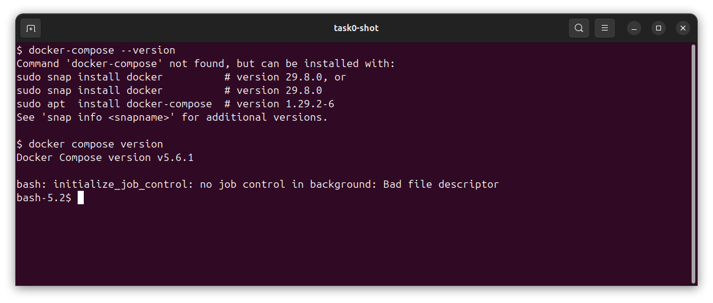
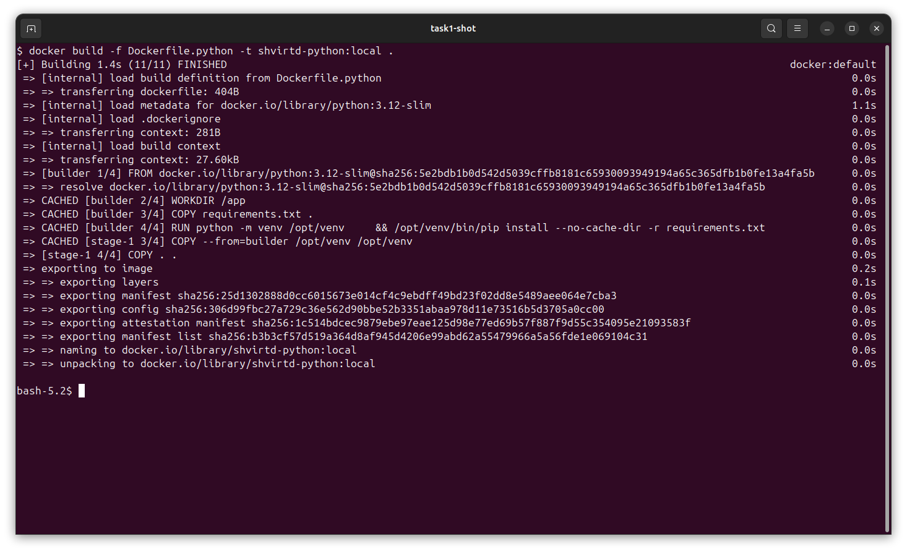
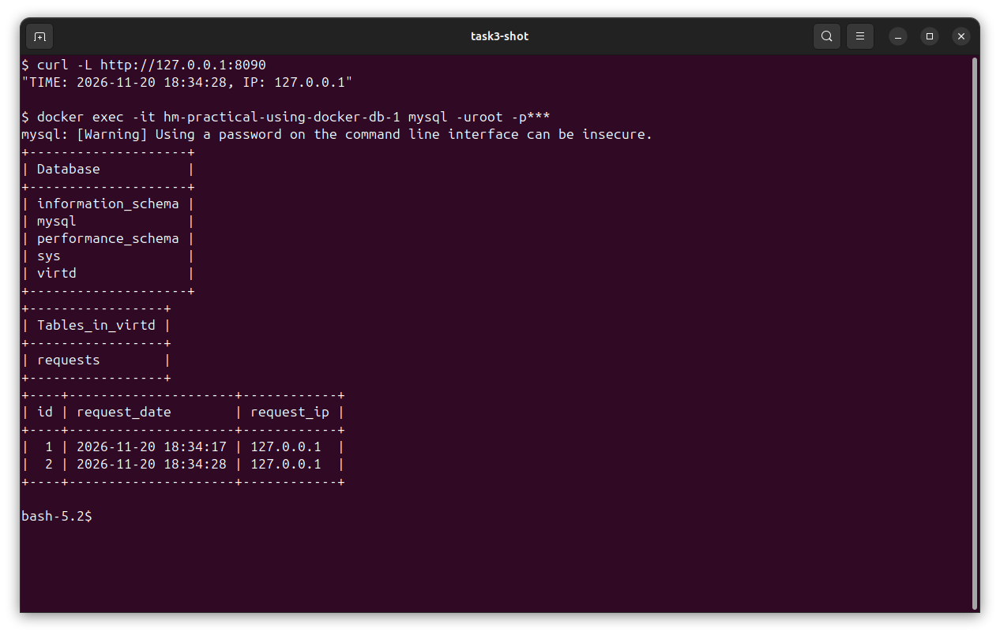
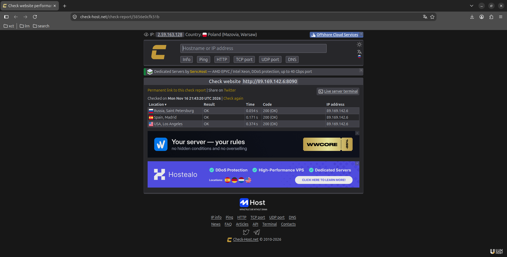
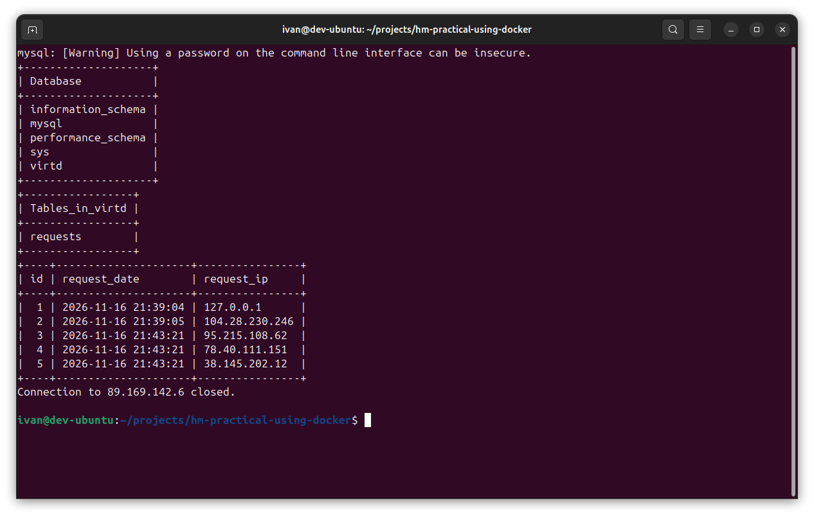
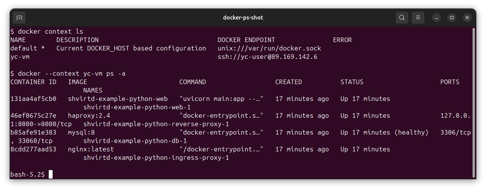
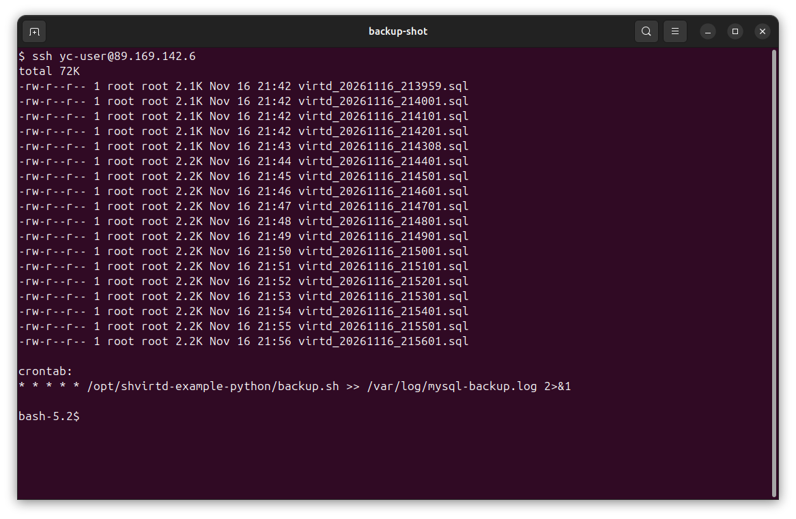
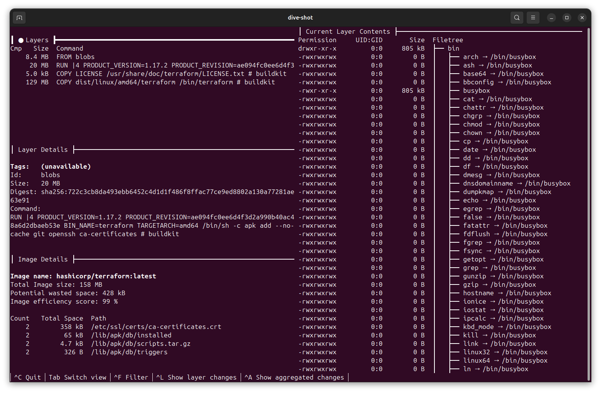
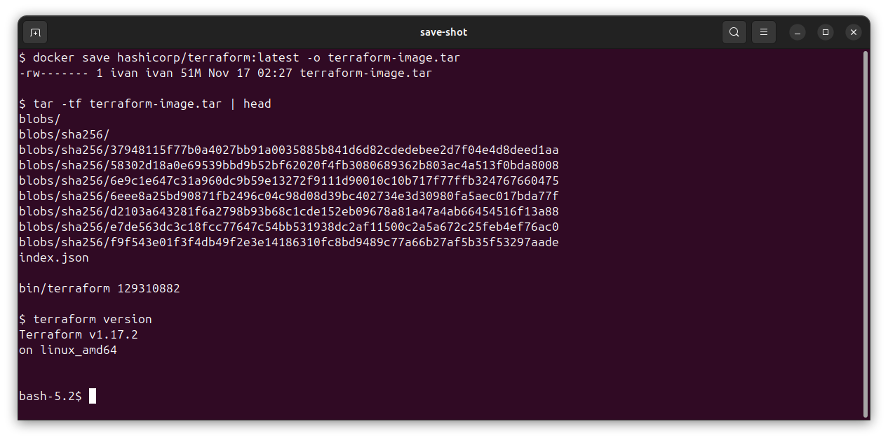

# Отчёт по домашнему заданию «Практическое применение Docker»

Форк: https://github.com/kinnwailos/shvirtd-example-python

Исходные файлы форка не изменялись. Решение добавлено отдельными файлами: `Dockerfile.python`, `compose.yaml`, `.dockerignore`, `.gitignore`, `deploy.sh`, `backup.sh`.

## Задача 0

`docker-compose` с дефисом в системе нет. Плагин `docker compose` установлен, версия v5.6.1 (требование — не ниже v2.24).



## Задача 1

`Dockerfile.python` — multistage-сборка на `python:3.12-slim`.

- Стадия `builder` ставит зависимости в `/opt/venv`.
- Финальная стадия копирует это окружение и исходники командой `COPY . .`.
- Запуск: `CMD ["uvicorn", "main:app", "--host", "0.0.0.0", "--port", "5000"]`.
- `.dockerignore` не пускает в контекст сборки `.git`, `.env`, конфиги прокси, скрипты и отчёт.

Проверка сборки:



## Задача 2

В Yandex Cloud создан Container Registry `test` (`crpl31l01ibecrq4epuq`). Локальный Docker авторизован в `cr.yandex`. Образ приложения запушен как `cr.yandex/crpl31l01ibecrq4epuq/shvirtd-python:latest` (id `crpnrt9d3e9ah7o26sjg`).

Сканирование `che2isvi342p2r6rumca` завершилось со статусом READY: HIGH 49, MEDIUM 90, LOW 65, UNDEFINED 5. Полный список — в [scan-report.txt](scan-report.txt).

## Задача 3

`compose.yaml` подключает `proxy.yaml` через `include` и описывает сервисы в bridge-сети `backend` (`172.20.0.0/24`):

| Сервис | Образ | Адрес | Перезапуск |
| --- | --- | --- | --- |
| `web` | сборка из `Dockerfile.python` | `172.20.0.5` | `always` |
| `db` | `mysql:8` | `172.20.0.10` | `always` |

Секреты MySQL и параметры приложения берутся из существующего `.env`. Приложение ходит в базу по имени сервиса `db` (`DB_HOST=db`). HAProxy из `proxy.yaml` обращается к приложению по `172.20.0.5:5000`, Nginx публикует сайт на порту 8090.

Локальная проверка `curl -L http://127.0.0.1:8090` вернула время и `127.0.0.1`. После запроса в базе `virtd` есть таблица `requests`. Проект после проверки остановлен (`docker compose down`).



## Задача 4

Виртуальная машина `shvirtd-docker` в зоне `ru-central1-a`, 2 ГБ RAM. Внешний адрес: `89.169.142.6`. Пользователь SSH: `yc-user`. На машине установлен Docker Engine и Docker Compose v5.7.1.

`deploy.sh` проверяет наличие `git` и `docker compose`, клонирует форк в `/opt/shvirtd-example-python` и запускает `docker compose up -d --build`.

Проверка снаружи: https://check-host.net/check-report/5856e0cfk51b — HTTP 200 из Санкт-Петербурга, Мадрида и Лос-Анджелеса.



Тот же SQL-запрос на сервере:



Удалённый Docker-контекст `yc-vm` (`ssh://yc-user@89.169.142.6`):



## Задача 5

`backup.sh` читает логин и пароль из `.env` в момент запуска и не хранит их в скрипте. Дамп снимает контейнер `schnitzler/mysqldump` в сети `backend`, файл пишется в `/opt/backup`.

Cron на ВМ, раз в минуту:

```cron
* * * * * /opt/shvirtd-example-python/backup.sh >> /var/log/mysql-backup.log 2>&1
```



## Задача 6

Образ `hashicorp/terraform:latest` просмотрен в `dive`: бинарник попадает в образ слоем `COPY dist/linux/amd64/terraform /bin/terraform` (129 МБ).



Тот же образ сохранён через `docker save`. Из слоя `e7de563dc3c18fcc77647c54bb531938dc2af11500c2a5a672c25feb4ef76ac0` извлечён `/bin/terraform`, версия 1.17.2.


